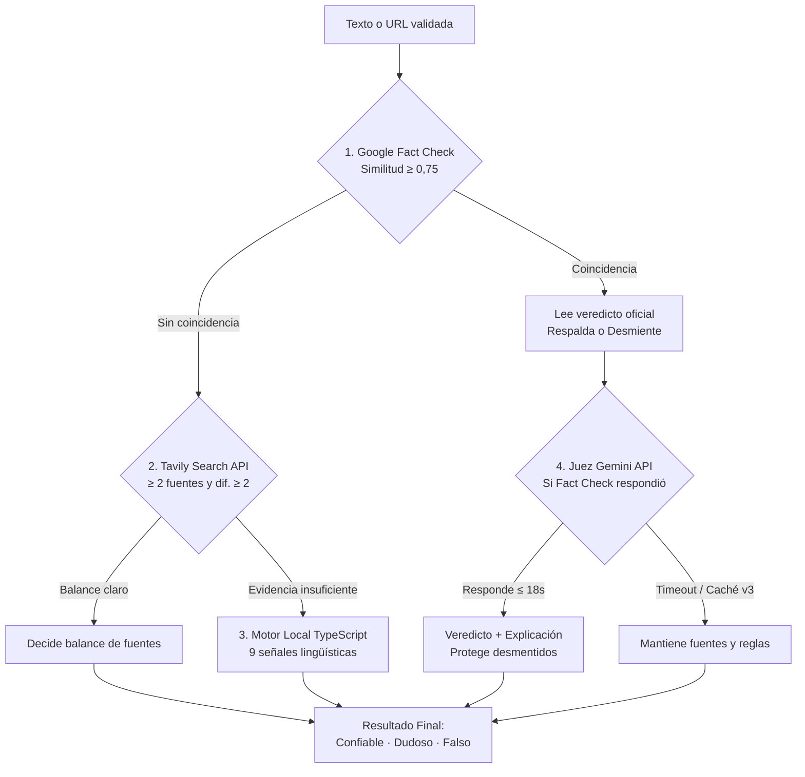

<div align="center">

# 🛡️ Factify

### Plataforma de verificación preliminar de noticias mediante IA, fuentes externas y reglas lingüísticas

*Verifica afirmaciones, enlaces y noticias antes de compartirlas: veredictos claros respaldados por evidencia trazable.*


[Explorar Demo](https://factifyyy.vercel.app) · [Stack Tecnológico](#-stack-tecnológico) · [Arquitectura](#%EF%B8%8F-arquitectura-y-flujo-de-decisión) · [Resultados Empíricos](#-resultados-y-validación) · [Instalación Local](#-instalación-y-despliegue) · [Roadmap](#%EF%B8%8F-limitaciones-conocidas-y-roadmap)

</div>

---

## 📖 Acerca del Proyecto

La desinformación en redes sociales circula más rápido que la verificación periodística tradicional. **Factify** es una aplicación web diseñada para ayudar a usuarios no expertos a contrastar afirmaciones concretas con evidencia externa antes de reenviarlas o publicarlas.

A diferencia de herramientas que entregan puntajes numéricos opacos, Factify combina **verificadores formales**, **búsqueda contextual de medios**, un **motor determinista de reglas lingüísticas** y **modelos de lenguaje (Gemini)** para clasificar cada consulta en tres categorías comprensibles —**Confiable**, **Dudoso** o **Falso**—, acompañadas de una explicación en lenguaje natural, enlaces a fuentes verificables y una alerta preventiva ante contenido riesgoso.

> [!NOTE]
> **Criterio ético conservador:** La ausencia de evidencia nunca se interpreta como falsedad. Cuando no existe respaldo suficiente o las fuentes se contradicen, Factify prioriza la categoría **Dudoso** antes que declarar falsa una afirmación sin sustento.

---

## 🧰 Stack Tecnológico

**Frontend & Interfaz**  


**Backend, Serverless & Base de Datos**  


**Inteligencia Artificial & APIs de Contraste**  


---

## ✨ Funcionalidades Principales

* 📝 **Verificación por Texto o Enlace Web (URL):** Ingreso manual de afirmaciones ($20$ a $10.000$ caracteres) o extracción automática de titulares y cuerpo desde artículos digitales mediante parsing HTML y metadatos OpenGraph.
* 🔍 **Contraste Trazable con Fuentes Externas:** Consulta verificaciones publicadas por organismos de fact-checking y recupera noticias recientes con enlaces directos a los medios.
* 🧠 **Explicación Educativa en Lenguaje Claro:** Justifica el motivo de cada clasificación y señala patrones detectados (lenguaje alarmista, clickbait, atribución vaga o ausencia de fuentes).
* ⚠️ **Alerta Preventiva Previa a Compartir:** Despliega una advertencia consciente (`AlertModal`) cuando el usuario intenta difundir contenido clasificado como **Dudoso** o **Falso**.
* 🕒 **Historial Privado en el Navegador:** Almacena hasta $100$ verificaciones recientes en `LocalStorage` con búsqueda instantánea y filtros por categoría, sin requerir cuentas de usuario.
* 📚 **Módulo de Alfabetización Mediática:** Guías interactivas categorizadas en *sesgos cognitivos*, *clickbait* y *evaluación de fuentes*.
* 👍 **Retroalimentación de Utilidad:** Permite valorar si la explicación fue útil y registrar observaciones en PostgreSQL.

---

## ⚙️ Arquitectura y Flujo de Decisión

Factify implementa una arquitectura web en capas desplegada de forma serverless en **Vercel** con persistencia relacional en **Supabase (PostgreSQL)**.

### Pipeline de Clasificación en 4 Etapas



1. **Verificación Formal (`Google Fact Check Tools API`):** Busca chequeos previos publicados por organizaciones acreditadas (`ClaimReview`). Si la similitud es $\ge 0,75$, adopta su veredicto real (distinguiendo entre respaldo y desmentido).
2. **Búsqueda Contextual (`Tavily Search API`):** Recupera noticias relevantes filtradas por términos clave ($\min(n, \max(2, \lceil 0,3 \cdot n \rceil))$) y evalúa el balance cuando existen al menos $2$ fuentes y una diferencia $\ge 2$.
3. **Motor Determinista Local (`shared/analyzer.ts`):** Analiza $9$ señales lingüísticas (lenguaje alarmista, clickbait, manipulación, exclamaciones, mayúsculas enfáticas y citas de fuentes) como respaldo offline.
4. **Juez IA con Contexto Temporal (`Gemini API` + `llm_cache`):** Evalúa la afirmación junto con las fuentes recuperadas y la fecha actual mediante una cadena de respaldo de hasta 4 modelos (`gemini-3.1-flash-lite`, `gemini-3.5-flash-lite`, `gemini-3.5-flash`, `gemini-3-flash-preview`), impidiendo que un veredicto marque como *Confiable* una afirmación desmentida por un verificador cercano.

---

## 🗂️ Estructura del Repositorio

```text
Factifyyy/
├── frontend/               # Interfaz SPA en React 18, TypeScript y Vite
│   └── src/
│       ├── pages/          # HomePage, ResultPage, HistoryPage, TipsPage
│       ├── components/     # AlertModal, SourcesCard, Navbar, WelcomeSection
│       └── services/       # verifyClient, historyService
├── api/                    # Funciones Serverless en Vercel (/api/*)
│   ├── verify.ts           # Endpoint principal de verificación textual
│   ├── analyze-url.ts      # Extracción y verificación desde enlaces web
│   ├── feedback.ts         # Registro de votos de utilidad
│   ├── fact-check.ts       # Consulta directa de fuentes externas
│   ├── evaluation.ts       # Métricas de evaluación (protegido por admin key)
│   └── health.ts           # Healthcheck del servicio
├── backend/services/       # Orquestación, integraciones API, caché LLM y Supabase
├── shared/                 # Motor determinista (analyzer.ts) y validación compartida
├── data/                   # Conjuntos etiquetados (sintético, real, reserva y final)
├── scripts/                # Script CLI de evaluación y matriz de confusión
└── supabase/               # Esquema SQL (verifications_log, user_feedback, llm_cache)
```

---

## 📊 Resultados y Validación

El sistema fue evaluado sobre conjuntos de noticias reales verificadas que **no fueron utilizados durante el ajuste de reglas** (evitando sobreajuste), además de una prueba empírica con usuarios:

| Evaluación | Conjunto / Muestra | Exactitud | Métricas Clave |
| :--- | :--- | :---: | :--- |
| **Conjunto de Reserva** | $40$ noticias reales no vistas | **$90,0\%$** ($36/40$) | F1 Macro: $90,1\%$ · $0\%$ falsos negativos en bulos |
| **Conjunto Final** | $30$ noticias reales no vistas | **$90,0\%$** ($27/30$) | F1 Macro: $89,8\%$ · $0\%$ falsos negativos en bulos |
| **Validación con Usuarios** | $11$ participantes ($22$ casos) | **$63,6\% \rightarrow 90,9\%$** | $+27,3\text{ pp}$ de mejora · Facilidad: $4,91/5$ · Comprensión: $4,64/5$ |

> [!IMPORTANT]
> **Cero falsos negativos críticos:** Entre las $22$ afirmaciones falsas incluidas en los conjuntos de reserva y final, **ninguna ($0/22$)** fue clasificada como *Confiable*.

---

## 🔌 Endpoints de la API

| Método y Ruta | Payload / Query | Respuesta (`200 OK`) | Códigos de Error |
| :--- | :--- | :--- | :--- |
| `POST /api/verify` | `{ "text": "..." }` | Clasificación, explicación, señales, fuentes e `id` | `400` ($<20$ chars), `413` ($>10.000$ chars) |
| `POST /api/analyze-url` | `{ "url": "https://..." }` | Texto extraído y resultado completo de verificación | `400` (URL inválida), `422` (no legible), `403`/`404` |
| `POST /api/feedback` | `{ "verificationId", "vote" }` | Confirmación de voto (`helpful` / `not_helpful`) | `400` (campos faltantes o inválidos) |
| `POST /api/fact-check` | `{ "text": "..." }` | Resultados crudos de Google Fact Check y Tavily | `400` (texto inválido) |
| `GET /api/evaluation` | `?split=final&mode=llm` | Exactitud, F1 y matriz de confusión $3\times3$ | `401` (`FACTIFY_ADMIN_KEY` inválida) |
| `GET /api/health` | — | `{ "ok": true, "service": "factify-api" }` | — |

---

## 🚀 Instalación y Despliegue

### Prerrequisitos

* **Node.js 20+** y **Git**
* Cuentas y claves API para: [Supabase](https://supabase.com/), [Google Cloud (Fact Check Tools API)](https://developers.google.com/fact-check/tools/api), [Google AI Studio (Gemini API)](https://aistudio.google.com/) y [Tavily Search API](https://tavily.com/).

### 1. Clonar e instalar dependencias

```bash
git clone https://github.com/MrPipe7/Factifyyy.git
cd Factifyyy
npm install
npm run install:frontend
```

### 2. Configurar base de datos en Supabase

Ejecuta el contenido de `supabase/schema.sql` en el **SQL Editor** de tu proyecto en Supabase para crear las tablas `verifications_log`, `user_feedback` y `llm_cache` junto con sus índices y políticas RLS.

### 3. Variables de entorno

Crea un archivo `.env` en la raíz del proyecto basado en `.env.example`:

```env
SUPABASE_URL=https://tu-proyecto.supabase.co
SUPABASE_ANON_KEY=tu_supabase_anon_key
GOOGLE_FACT_CHECK_API_KEY=tu_google_fact_check_key
TAVILY_API_KEY=tu_tavily_api_key
GEMINI_API_KEY=tu_gemini_api_key
FACTIFY_ADMIN_KEY=clave_secreta_para_evaluacion
```

### 4. Ejecutar en desarrollo

```bash
# Levantar solo el frontend (Vite)
npm run dev

# Levantar frontend + funciones serverless locales (Vercel CLI)
npm run dev:vercel
```

### 5. Reproducir evaluación técnica

```bash
npx tsx scripts/run-evaluation.mjs --split final --mode llm
```

---

## 🛠️ Limitaciones Conocidas y Roadmap

Como proyecto desarrollado en entorno académico con servicios de capa gratuita, se documentan de forma transparente las limitaciones actuales y mejoras planificadas:

* [ ] **Soporte completo de video (`HU18` / `RF17`):** La extracción de subtítulos de YouTube opera en desarrollo local, pero es bloqueada por YouTube desde las IPs de Vercel en producción. *Próximo paso:* pestaña para pegado manual de transcripciones y servicio dedicado con Whisper/STT.
* [ ] **Invocación incondicional del juez IA (`E-02` / `CAM-08`):** Actualmente Gemini solo se consulta cuando Google Fact Check devuelve coincidencias; se ampliará para evaluar todos los casos con evidencia de Tavily y capturar fallos de red (`E-01`).
* [ ] **Endurecimiento de seguridad:** Incorporar validación DNS/bloqueo de rangos privados (mitigación SSRF en `/api/analyze-url`) y restringir lecturas/actualizaciones de Supabase mediante `service_role`.
* [ ] **Calibración de casos ambiguos y latencia:** Ajustar el prompt para reducir el sesgo conservador en noticias dudosas (donde $7/70$ casos fueron marcados como falsos) y optimizar el arranque en frío ($p95 = 21,7\text{ s}$).

---

## 👤 Autor y Contexto Académico

* **Autor:** Felipe Figueroa ([@MrPipe7](https://github.com/MrPipe7))
* **Institución:** Escuela de Ingeniería en Computación e Informática — Facultad de Ingeniería, Universidad Andrés Bello.
